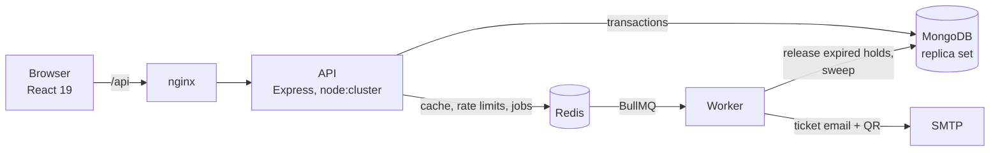

# TicketRush

A flash-sale ticket booking system (MERN) built around one rule: **a seat is never sold twice**, even when a thousand people press "Book" in the same second.

Fans pick seats on a live seat map, hold them for 5 minutes and pay. Organisers build events and seat maps and watch sales. Admins see live stats and can block abusive accounts. Under load, the API keeps every booking consistent with every seat and every payment, and it keeps working when Redis goes down.

**Load test (1,000 fans, 100 seats): 100 bookings, 0 double-bookings, 0 server errors.** See [Results](#load-test-results).

## How it never double-books

Every change to a seat is a **conditional update inside a MongoDB transaction**: the write only happens if the seat is still in the state the flow expects.

```js
// Hold (SRS 6.1): all requested seats go available → held, or none do.
const { modifiedCount } = await Seat.updateMany(
  { _id: { $in: seatIds }, eventId, status: 'available' },
  { $set: { status: 'held', holdId } },
  { session },
);
if (modifiedCount !== seatIds.length) throw seatTaken(); // the transaction aborts; nothing is held
```

- **Holds:** two fans racing for one seat cannot both win. One update matches; the other matches nothing and gets `409 SEAT_TAKEN`. Write conflicts retry up to 3 times, then answer 409, never 500.
- **Payment:** confirming a hold needs an `Idempotency-Key`. The first request claims the key through a unique index, and repeats replay the stored answer. A double-click, a retry after a timeout or a page reload can never book or charge twice. A declined payment frees the key so the same key can retry.
- **Expiry vs payment:** the confirm converts the hold only `if status is 'active' and expiresAt > now`. The expiry job releases it only `if status is 'active' and expiresAt <= now`. Exactly one of them wins; a payment that loses is refunded.
- **Last guard:** a partial unique index on the seats of confirmed bookings makes a duplicate physically impossible to store.
- **Redis is never the source of truth.** The cache, rate limits and job queue can all disappear; reads fall back to MongoDB, and an every-minute sweep releases expired holds whose jobs were lost.

The full design is in the [Software Requirements Specification](docs/SRS.md).

## Architecture



| Part | Stack |
| --- | --- |
| API | Node 22, Express 4, Mongoose 8, zod 4, JWT access tokens plus rotating httpOnly refresh cookies, pino, helmet, Swagger at `/docs` |
| Data | MongoDB 7+ replica set (needed for transactions), Redis 7 via ioredis |
| Jobs | BullMQ 6: delayed `release-hold` jobs, confirmation emails with QR codes (nodemailer), a sweep that needs only MongoDB |
| Web app | React 19, React Router 7, Vite 8, plain CSS with light and dark themes; works at phone width |
| Tests | Jest + Supertest on an in-memory MongoDB replica set; Vitest + React Testing Library; k6 |

## Features

- **Fans:** search events by city and date; a seat map that refreshes every 5 s; hold up to 6 seats with a countdown; pay; QR tickets; cancel up to 24 h before the event.
- **Organisers:** create and edit draft events with a section and row seat-map builder, publish, and watch live sales (seats sold, revenue, active holds).
- **Admins:**
  - live stats: a bookings-per-minute chart, failed hold attempts per event, time to sell out
  - user search, plus block and unblock (blocking logs the user out everywhere immediately)
- **Platform:**
  - per-user and per-IP rate limits
  - Redis caching of hot reads
  - structured logs with a request ID on every line and in every error
  - plain-language error messages

## Run it

**Everything in Docker** (MongoDB replica set, Redis, API, worker, web app):

```bash
docker compose up -d --build --wait
# App:     http://localhost:5173
# API:     http://localhost:4000      Swagger: http://localhost:4000/docs
# Admin:   docker compose exec -e ADMIN_EMAIL=you@example.com -e ADMIN_PASSWORD='a-long-password' api node scripts/seedAdmin.js
```

**Or run the parts on your machine** (needs MongoDB as a replica set and Redis, for example from the same Compose file):

```bash
cp server/.env.example server/.env        # set JWT_ACCESS_SECRET
cd server && npm install && npm run dev        # API on :4000
cd server && npm run dev:worker                # jobs and the sweep
cd client && npm install && npm run dev        # app on :5173, proxies /api to :4000
```

Emails are written to the log until you set `SMTP_URL` (any provider: Ethereal, Mailtrap, a real one).

**Deploy for free** (Render + MongoDB Atlas): [render.yaml](render.yaml) creates one web service that runs the API and the jobs (`RUN_WORKER_IN_API=true`) and serves the built app (`CLIENT_DIST`), plus a free Redis. In Render choose New → Blueprint, pick the repo, and paste an Atlas connection string as `MONGO_URI`. The free instance sleeps after 15 minutes idle; on wake, the sweep releases any holds that expired meanwhile.

## Tests

```bash
cd server && npm test    # 153 tests: API, race, idempotency, expiry, worker; about 93% line coverage
cd client && npm test    # 36 tests: countdown, seat map, one key reused on Pay retry, chart, forms
```

The server tests include the SRS acceptance tests:

- 100 parallel holds on one seat: exactly 1 wins
- 50 overlapping parallel holds: never a shared seat
- 5 parallel confirms with one key: 1 booking
- a declined payment, then a retry with the same key: one booking
- confirm racing expiry: always exactly one outcome
- cancel, then rebook

`tests/worker.redis.test.js` also runs BullMQ against a real Redis when one answers at `REDIS_TEST_URL`.

## Load test results

Run on 2026-11-23. **Machine:** Intel Core i5-12500H (12 cores, 16 threads), 16 GB RAM, SSD, Windows 11. **Stack:** native, not Docker (Docker was unavailable on the test machine):

- 4 API processes (`WEB_CONCURRENCY=4`) and the worker
- MongoDB 8.2 single-node replica set
- Redis-compatible Memurai 8.2
- k6 2.4 on the same machine

Load-test settings: payment delay 0, per-IP limits off. Raw summaries are in [loadtest/results](loadtest/results).

| Scenario | Fans | Seats | Bookings | Double-bookings | Server errors | Hold p95 | Confirm p95 |
| --- | --- | --- | --- | --- | --- | --- | --- |
| Flash sale: everyone presses Book at the instant the sale opens | 1,000 | 100 | 100 | **0** | **0** | 3.18 s | 2.15 s |
| Sustained: 1,000 fans arriving over 20 s, everyone buys | 1,000 | 1,000 | 996 | **0** | **0** | **124 ms** | **204 ms** |
| Redis killed for 12 s mid-sale, comes back empty; 30% of holders walk away | 600 over 60 s | 300 | 285 | **0** | **0** | 15 ms | 27 ms |

After every run, `loadtest/verify.js` checks MongoDB. In all three runs:

- the SRS duplicate-seat aggregation was empty
- booked seats equalled the seats in confirmed bookings
- every successful charge had a booking
- no expired hold was left active

In the Redis run:

- 130 release jobs could not be queued during the outage, and all 90 abandoned holds were still released by the sweep
- 20% of buyers sent their confirm twice, and every repeat returned the same booking

**What missed the target, and why.** The spec asks for hold and confirm p95 under 300 ms at 1,000 concurrent users.

- **Sustained load meets it.** The 1,000-fans-in-one-instant burst does not.
- **Profiling settled the cause:**
  - The API is not the bottleneck: going from 1 to 4 processes cut the burst hold p95 from about 4.8 s to about 3 s, and more processes stopped helping.
  - The limit is MongoDB's transaction rate: about 1,900 transactions a second on this laptop's single-node replica set, measured.
  - The burst needs over 2,000 transactions in its first second (1,000 holds plus conflict retries), so the last fans in the queue wait 2–3 s.
- Correctness is unaffected. Closing the gap needs faster MongoDB hardware or Linux, which Docker provides.
- To reproduce:

  ```bash
  docker compose -f docker-compose.yml -f loadtest/docker-compose.loadtest.yml up -d --build --wait
  k6 run loadtest/flash-sale.js
  MONGO_URI="mongodb://localhost:27017/ticketrush?directConnection=true" node loadtest/verify.js <eventId printed by k6>
  ```

## Project layout

```
server/      Express API (src/modules/*), worker (src/worker.js, src/jobs), models, tests
client/      React app (src/pages, src/components, src/api)
loadtest/    k6 flash-sale script, load-test Compose profile, verifier, results
docs/        SRS.md (the spec) and PROGRESS.md (build log, decisions, known limitations)
```

## Known limitations

These are tracked in [docs/PROGRESS.md](docs/PROGRESS.md):

- **Emails:** booking emails are lost if Redis is down when the booking is made. The booking itself is not affected.
- **Two tabs:** two tabs refreshing a session at the same instant can log the user out, because refresh-token reuse detection treats the second refresh as theft.
- **Load-test environment:** the load-test numbers above come from a Windows laptop, not Docker.
