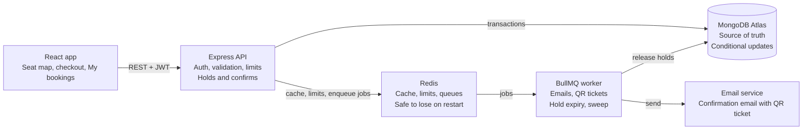

# TicketRush — Software Requirements Specification v2

Nov 23, 2026 · @Tushar · Live doc: https://claude.ai/artifact/XDy24h8RPCbb2onVi1qmW3

## Changes from v1

v2 keeps the v1 design and fixes the gaps found in review: the race conditions around confirm, how idempotency works, and requirements that were mentioned but never specified.

| Area | Change in v2 |
| --- | --- |
| Idempotency | Keys are unique per user; a key is claimed before work starts; a 402 is not stored, so payment can be retried; a reused key with a different body gets 422 |
| Confirm | Payment runs outside the transaction; the transaction converts the hold only if it is still active and not expired; paid-but-expired gets 410 and a simulated refund |
| Expiry | The release job and the sweep only release holds still `active`, so they can never undo a confirmed booking |
| Concurrency | Write conflicts are retried and then mapped to 409, never 500 |
| Cancel | Cancelling returns the seats to `available`; booking statuses are defined |
| Sales window | Holds are rejected before `saleStartsAt`; organisers publish events with a new endpoint; `soldOutAt` is recorded |
| Admin and organiser | Block users, view per-event sales; admins are created by a seed script |
| Anti-scalping | At most 2 active holds per user per event |
| Auth | Refresh token in an httpOnly cookie, rotated on use, revocable; logout added |
| Tickets | Each booking stores a ticket code; the QR is generated from it |
| Caching | Seat map uses a 2 s TTL and is not cleared on every write |
| Testing | Load tests run on the local Docker stack; rate limits can be relaxed for them; frontend tests added |
| Wording | Four roles, not three; "locked transaction" and Redis "locks" removed; `hold:<id>` key dropped |

## 1. Introduction

TicketRush is a MERN app (MongoDB, Express, React, Node.js) for flash-sale ticket booking that never sells the same seat twice, even under 1,000+ concurrent requests.

### 1.1 Purpose

This document defines what TicketRush must do and how well it must do it. It is the reference for building, testing and explaining the project in interviews.

### 1.2 Scope

TicketRush is a Node.js and Express REST API with a React frontend, on MongoDB Atlas. It covers:

- User and organiser accounts with JWT auth
- Events with seat maps (sections, rows, seats, prices) and a sale start time
- Temporary seat holds that expire after 5 minutes
- Booking confirmation with a simulated payment and idempotent retries
- Background jobs for emails, QR tickets and releasing expired holds
- Rate limiting, caching, admin stats and user blocking

The React frontend stays simple: an event list, a clickable seat map, a 5-minute countdown while paying, and a My bookings page. The backend is the focus of the project.

### 1.3 Definitions

| Term | Meaning |
| --- | --- |
| Hold | Seats reserved for one user for a limited time (5 minutes) while they pay |
| Booking | A confirmed purchase of one or more held seats |
| Idempotency key | A unique key the client sends with a request so a retried request is processed only once |
| TTL | Time to live: how long a Redis key or a MongoDB document exists before it expires |
| Double-booking | Two confirmed bookings for the same seat, which must never happen |
| Conditional update | A MongoDB update that changes a document only if it still matches a condition (for example `status: 'available'`), so two users can never both win it |
| Write conflict | A MongoDB error raised when two transactions change the same document at once; the losing transaction must retry or abort |
| Sweep | A job that runs every minute and releases any active hold whose `expiresAt` has passed |
| Ticket code | A random, unguessable string stored on a booking and encoded in its QR code |

## 2. Overall description

TicketRush serves four roles through one REST API, and runs as four parts: the React app, the API, a background worker, and its data stores (MongoDB and Redis).

### 2.1 User roles

| Role | Can do | How the account is created |
| --- | --- | --- |
| Guest | Browse events and see live seat availability | No account |
| User | Hold seats, confirm bookings, view and cancel their bookings | Self sign-up |
| Organiser | Create, edit and publish events, set seat maps and prices, see sales for their own events | Self sign-up with role `organiser` |
| Admin | See system-wide stats, block and unblock users | Seed script only (`npm run seed:admin`); never through the API |

A blocked account cannot log in, refresh a token, hold seats or confirm bookings. Its existing bookings stay valid.

### 2.2 Tech stack

| Layer | Choice |
| --- | --- |
| Frontend | React + Vite + Tailwind CSS |
| API | Node.js + Express 4 |
| Main database | MongoDB Atlas with Mongoose (source of truth for seats, holds and bookings) |
| Cache, rate limits, counters | Redis |
| Background jobs | BullMQ on Redis |
| Validation | zod, with strict schemas on every body, query and param |
| Local setup | Docker Compose (React, API, worker, MongoDB single-node replica set, Redis) |
| Docs and tests | Swagger (OpenAPI), Jest + Supertest, Vitest + React Testing Library, k6 for load tests |

Express is pinned to version 4 because `express-mongo-sanitize` breaks on Express 5, where `req.query` is read-only.

### 2.3 Constraints

- No real payments: payment is simulated, with a configurable success rate (`PAYMENT_SUCCESS_RATE`) and delay (`PAYMENT_DELAY_MS`).
- Free hosting tiers for the deployed demo, so the system must stay correct on a single small instance.
- MongoDB is the source of truth. Redis may lose data on restart without causing a double-booking or a lost booking.
- Multi-document transactions need MongoDB running as a replica set: Atlas does this by default, and Docker Compose runs a single-node replica set locally.
- Performance targets (NFR-3, NFR-4) are measured on the local Docker stack, not on the free Atlas tier (M0 allows 500 connections and has throttled throughput).

### 2.4 Assumptions

- One hold, and so one booking, has 1 to 6 seats, all in the same event.
- A user has at most 2 active holds per event at a time (`MAX_ACTIVE_HOLDS_PER_EVENT`).
- A hold lasts 5 minutes (`HOLD_TTL_SECONDS`, default 300); an unpaid hold is released automatically.
- All times are stored in UTC.
- Prices are stored in paise as integers.

## 3. System architecture

Every booking decision happens inside a MongoDB transaction; Redis holds only copies, counters and job queues, so losing it never breaks correctness.



The React app talks only to the API. The API writes seats, holds and bookings to MongoDB through Mongoose, and puts slow work (emails, hold expiry) on BullMQ queues in Redis. A separate worker process runs those jobs. Its writes to MongoDB follow the same conditional-update rule as the API (section 6), and a sweep every minute catches any expired hold whose delayed job was lost.

## 4. Functional requirements

Each requirement has an ID so tests and commits can point to it. v1 IDs are kept; new requirements start at FR-26. Must = needed for version 1, Should = add once Must is done.

### 4.1 Backend

| ID | Area | Requirement | Priority |
| --- | --- | --- | --- |
| FR-1 | Auth | Users and organisers sign up and log in with email and password; passwords are hashed with bcrypt (cost 12) | Must |
| FR-2 | Auth | Login returns a JWT access token (15 min) in the body and sets a refresh token (7 days) in an httpOnly, Secure, SameSite=Strict cookie | Must |
| FR-26 | Auth | Every refresh rotates the refresh token; reusing an old one revokes all of that user's refresh tokens. `POST /auth/logout` revokes the current one | Must |
| FR-3 | Auth | Routes check the role (user, organiser, admin) and that the account is not blocked before running | Must |
| FR-4 | Events | An organiser creates an event with name, venue, city, start time, sale start time and a seat map of sections, rows and seats with prices. It starts as `draft` and can be edited until it is published | Must |
| FR-27 | Events | An organiser publishes a draft event, which sets it to `on_sale`. Holds on an event are rejected if it is not `on_sale` or `saleStartsAt` is in the future | Must |
| FR-5 | Events | Anyone can list published events (filters by city and date, paginated) and view one event | Must |
| FR-6 | Events | An event page shows each seat as available, held or booked | Must |
| FR-28 | Events | When the last available seat is booked, the event becomes `sold_out` and `soldOutAt` is recorded once. A cancellation sets it back to `on_sale` but keeps the first `soldOutAt` | Should |
| FR-7 | Holds | A logged-in user can hold 1 to 6 available seats of one event; every seat must belong to that event; the hold lasts 5 minutes | Must |
| FR-8 | Holds | If any requested seat is not available, the whole hold fails with 409 and no seat is held | Must |
| FR-29 | Holds | A user can have at most 2 active holds per event; a third gets 429 `TOO_MANY_HOLDS` | Should |
| FR-9 | Holds | An unpaid hold is released automatically when it expires, and its seats become available again | Must |
| FR-10 | Holds | A user can release their own active hold early | Should |
| FR-11 | Booking | A user confirms a hold with an `Idempotency-Key` header. A finished result (201 or 410) is stored for 24 hours and returned for every repeat of that key. A request with the same key and a different body gets 422. A request that arrives while the first is still running gets 409 `REQUEST_IN_PROGRESS` | Must |
| FR-12 | Booking | Confirmation runs a simulated payment. On success the seats become booked. On failure the API returns 402, the hold stays until it expires, and the key is freed so the same key can retry payment | Must |
| FR-13 | Booking | A booking cannot be created for an expired, released or already converted hold. If payment succeeded but the hold expired meanwhile, the API returns 410 and records a simulated refund | Must |
| FR-14 | Booking | A user can list their bookings and cancel one up to 24 hours before the event | Should |
| FR-30 | Booking | Cancelling a booking sets it to `cancelled` and returns its seats to `available` in the same transaction | Should |
| FR-15 | Jobs | After a booking, a background job emails a confirmation with a QR code of the booking's ticket code | Must |
| FR-16 | Jobs | A failed job retries 3 times with exponential backoff (1 s, 4 s, 16 s), then stays in the queue's failed set for inspection | Should |
| FR-17 | Limits | Requests are rate-limited per user and per IP; hold and booking routes have stricter limits. Limits are set by environment variables so load tests can raise them | Must |
| FR-18 | Admin | An admin endpoint shows bookings per minute, failed hold attempts per event and time to sell out per event | Should |
| FR-31 | Organiser | An organiser can see seats sold, revenue and holds active for each of their own events | Should |
| FR-32 | Admin | An admin can block and unblock a user; blocking revokes the user's refresh tokens | Should |
| FR-19 | Ops | `GET /health` reports the status of the API, MongoDB and Redis | Must |

### 4.2 Frontend (React)

| ID | Page | Requirement | Priority |
| --- | --- | --- | --- |
| FR-20 | Auth | Sign-up and login pages; the access token is kept in memory and refreshed automatically through the cookie | Must |
| FR-21 | Events | Event list with city and date filters, and an event page | Must |
| FR-22 | Seat map | A clickable seat map coloured by status (available, held, booked) that refreshes every 5 seconds | Must |
| FR-23 | Checkout | After a hold, a 5-minute countdown from the server's `expiresAt` and a Pay button. The page creates one idempotency key per checkout and reuses it for every retry | Must |
| FR-24 | Bookings | A My bookings page with QR tickets and a Cancel button | Should |
| FR-25 | Organiser | A form to create an event and its seat map, and a Publish button | Should |

## 5. Non-functional requirements

The most important rule is correctness under load: zero double-bookings at 1,000 concurrent requests. Speed comes second.

| ID | Area | Requirement | Target |
| --- | --- | --- | --- |
| NFR-1 | Correctness | No seat is ever booked twice | 0 double-bookings in every test |
| NFR-2 | Concurrency | Holds, confirms, releases and cancels each run in one MongoDB transaction, and every write is a conditional update on the current status | All-or-nothing changes |
| NFR-13 | Concurrency | Transactions use `session.withTransaction()` with up to 3 retries on `TransientTransactionError`; a write conflict that still fails returns 409, never 500 | 0 responses of 500 in the race and load tests |
| NFR-3 | Performance | Event and seat-map reads are served from Redis cache | p95 under 100 ms (local Docker stack) |
| NFR-4 | Performance | Hold and booking requests | p95 under 300 ms at 1,000 concurrent users (local Docker stack, payment delay 0) |
| NFR-5 | Reliability | If Redis restarts, no booking is lost or duplicated; MongoDB stays the source of truth | No data loss |
| NFR-6 | Reliability | Expired holds are released even if the delayed job was lost, by a sweep job every minute | Freed within 1 min of expiry |
| NFR-7 | Security | Inputs are validated with strict zod schemas; MongoDB operators such as `$gt` are stripped from user input (express-mongo-sanitize); secrets come from environment variables | No NoSQL injection |
| NFR-8 | Security | Passwords hashed with bcrypt; JWTs signed and short-lived; refresh tokens stored only as SHA-256 hashes; CORS limited to the React app's origin with credentials; cookie is SameSite=Strict | |
| NFR-14 | Security | Users can only read or change their own holds and bookings; organisers only their own events. Another user's ID returns 404, not 403 | No ID enumeration |
| NFR-9 | Observability | Structured logs (pino) with a request ID on every line; the request ID is returned in the `X-Request-Id` header and in every error body | Every request traceable |
| NFR-10 | Maintainability | Code split into routes, services and models; API documented in Swagger | Every endpoint documented |
| NFR-11 | Portability | `docker compose up` starts the whole system locally, including the replica set | One command |
| NFR-12 | Usability | The React app works on phone screens and shows clear messages when a seat is taken, a hold expires or payment fails | |

## 6. Core flows

Every flow that changes a seat follows one rule: change a document only if its status is still what the flow expects, inside one transaction. Because of that rule, a confirm and an expiry can race safely, and only one of them wins.

### 6.1 Hold seats (FR-7, FR-8, FR-29)

1. Validate the body: 1 to 6 unique seat IDs. Check the event is `on_sale` and `saleStartsAt` has passed (else 403 `SALE_NOT_STARTED`).
2. Count the user's active holds on this event. If there are already 2, return 429 `TOO_MANY_HOLDS`. This check is outside the transaction, so a rare race can allow a third hold. It guards against abuse, not double-booking.
3. Start a transaction with `withTransaction()`:
   1. `seats.updateMany({ _id: { $in: seatIds }, eventId, status: 'available' }, { $set: { status: 'held', holdId } })`.
   2. If `modifiedCount` is less than the number of seats, abort: another user got there first, so no seat stays held.
   3. Insert the hold with `status: 'active'` and `expiresAt = now + HOLD_TTL_SECONDS`, then commit.
4. If the transaction aborted or a write conflict survives 3 retries, return 409 `SEAT_TAKEN` and increment the failed-holds counter.
5. After commit, add a delayed BullMQ job `release-hold` with `jobId = holdId` and delay equal to the TTL. Return 201 with the hold and `expiresAt`.

### 6.2 Confirm a hold (FR-11 to FR-13)

1. **Claim the key.** Insert `{ userId, key, requestHash, status: 'processing' }` into `idempotencyKeys`. The unique index on `(userId, key)` lets only one request win. If the insert fails with a duplicate-key error:
   - stored as `completed` with the same hash → return the stored status and body
   - stored with a different hash → 422 `IDEMPOTENCY_KEY_REUSED`
   - still `processing` and younger than 60 s → 409 `REQUEST_IN_PROGRESS`; older → take it over (the first request crashed)
2. **Check the hold.** It must belong to the user (else 404). If it is not `active` or `expiresAt` has passed, store and return 410 `HOLD_EXPIRED`.
3. **Pay, outside any transaction.** On failure, delete the key document and return 402 `PAYMENT_FAILED`. The hold is unchanged, so the user can retry with the same key.
4. **Book, in one transaction:**
   1. `holds.updateOne({ _id, status: 'active', expiresAt: { $gt: now } }, { $set: { status: 'converted' } })`. If nothing matched, the hold expired during payment: abort.
   2. `seats.updateMany({ _id: { $in: seatIds }, holdId, status: 'held' }, { $set: { status: 'booked' } })`. If fewer seats changed than expected, abort.
   3. Insert the booking with `status: 'confirmed'`, `totalPaise` and a random `ticketCode`. The unique indexes on bookings are the last guard.
   4. Set the key document to `completed` with the 201 response. The booking and its stored response commit together, or neither does.
5. If step 4 aborted at 4.1, record a simulated refund on the payment, store 410 `HOLD_EXPIRED` and return it.
6. After commit: enqueue the confirmation email job, remove the `release-hold` job, and mark the event `sold_out` if no seat is left available (FR-28).

### 6.3 Release a hold: expiry, sweep or early release (FR-9, FR-10, NFR-6)

The delayed job, the every-minute sweep and `DELETE /holds/:id` all run the same transaction:

1. `holds.updateOne({ _id, status: 'active' }, { $set: { status: 'expired' } })`, or `'released'` for an early release. Expiry and sweep also require `expiresAt <= now`.
2. If nothing matched, stop. The hold was already converted or released, so its seats must not be touched.
3. `seats.updateMany({ holdId, status: 'held' }, { $set: { status: 'available', holdId: null } })`.

The sweep finds candidates with the `(status, expiresAt)` index. Running it twice on the same hold is harmless.

### 6.4 Cancel a booking (FR-14, FR-30)

1. Check the event starts more than 24 hours from now (else 409 `CANCEL_WINDOW_CLOSED`).
2. In one transaction: set the booking from `confirmed` to `cancelled`; set its seats from `booked` to `available` and unset `holdId`; if the event is `sold_out`, set it back to `on_sale`.
3. Cancelled bookings fall outside the partial unique index, so their seats can be booked again. Refunds stay out of scope.

## 7. Data model

Eight MongoDB collections hold every fact; Redis only holds short-lived copies, counters and job queues.

### 7.1 MongoDB collections

| Collection | Key fields | Indexes and notes |
| --- | --- | --- |
| users | _id, email, passwordHash, role, status, createdAt | unique email; role: user, organiser or admin; status: active or blocked |
| refreshTokens | _id, userId → users, tokenHash, familyId, expiresAt, revokedAt | unique tokenHash; TTL index on expiresAt; a reused revoked token revokes its whole family |
| events | _id, organiserId → users, name, venue, city, startsAt, saleStartsAt, status, soldOutAt | index (city, startsAt); index (organiserId); status: draft, on_sale, sold_out, ended |
| seats | _id, eventId → events, section, row, number, pricePaise, status, holdId | unique (eventId, section, row, number); index (eventId, status); index (holdId); status: available, held, booked |
| holds | _id, userId → users, eventId → events, seatIds [ ], expiresAt, status | index (status, expiresAt) for the sweep; index (userId, eventId, status) for the hold cap; status: active, converted, expired, released |
| bookings | _id, userId → users, holdId → holds, eventId, seatIds [ ], totalPaise, ticketCode, status, createdAt, cancelledAt, emailSentAt | unique holdId; unique ticketCode; partial unique index on seatIds where status is confirmed (the last guard against double-booking); index (userId, createdAt); status: confirmed, cancelled |
| payments | _id, userId, holdId, amountPaise, status, createdAt | index (holdId); status: succeeded, failed, refunded (simulated) |
| idempotencyKeys | userId, key, requestHash, status, responseStatus, responseBody, createdAt | unique (userId, key); TTL index deletes documents after 24 hours; status: processing or completed |

The partial unique index on `bookings.seatIds` is a multikey index: it stops two confirmed bookings sharing any seat. It does not stop one booking listing the same seat twice, so the hold route rejects duplicate seat IDs.

### 7.2 Redis keys

Redis may lose any of these keys without breaking correctness.

| Key | Holds | TTL |
| --- | --- | --- |
| `event:<id>` | Cached event details; deleted when the event is edited or published | 60 s |
| `seatmap:<eventId>` | Cached seat statuses; not cleared on writes, so it is at most 2 s stale | 2 s |
| `rl:<route>:<userId or ip>` | Rate-limit counter | 1 min window |
| `stats:failedHolds:<eventId>` | Failed hold attempts (best effort: lost on Redis restart) | 7 days |
| `bull:*` | BullMQ queues: `holds` (`release-hold` jobs, `jobId = holdId`) and `emails` (`booking-email` jobs) | managed by BullMQ; the prefix is `QUEUE_PREFIX`. The sweep is a timer in the worker, not a queue, so it keeps running while Redis is down |

Bookings per minute and time to sell out are computed from MongoDB (`bookings.createdAt`, `events.soldOutAt`), so they survive a Redis restart.

## 8. API specification

All routes start with `/api/v1` (except `/health` and `/docs`), take and return JSON, and are listed in full in Swagger at `/docs`.

### 8.1 Routes

| Method | Route | Who | What it does | Covers |
| --- | --- | --- | --- | --- |
| POST | /auth/register | Guest | Create a user or organiser account | FR-1 |
| POST | /auth/login | Guest | Returns an access token; sets the refresh cookie | FR-2 |
| POST | /auth/refresh | Guest with refresh cookie | Rotates the refresh token and returns a new access token | FR-2, FR-26 |
| POST | /auth/logout | User | Revokes the refresh token and clears the cookie | FR-26 |
| GET | /me | User | The signed-in account (used by the React app after a silent refresh) | FR-20 |
| POST | /events | Organiser | Create a draft event with its seat map | FR-4 |
| PATCH | /events/:id | Organiser (owner) | Edit a draft event and its seat map | FR-4 |
| POST | /events/:id/publish | Organiser (owner) | Set a draft event to on_sale | FR-27 |
| GET | /events | Guest | List published events; `?city=&from=&to=&page=&limit=` (limit max 50) | FR-5 |
| GET | /events/:id | Guest | One event (cached) | FR-5 |
| GET | /events/:id/seats | Guest | Seat map with status per seat (cached) | FR-6 |
| GET | /organiser/events | Organiser | Your events, drafts included, newest first; `?status=&page=&limit=` | FR-25 |
| GET | /organiser/events/:id | Organiser (owner) | One of your events with its seat map, for the edit form | FR-4, FR-25 |
| GET | /organiser/events/:id/sales | Organiser (owner) | Seats by status, confirmed and cancelled bookings, revenue from confirmed bookings, active holds | FR-31 |
| POST | /events/:id/holds | User | Body `{ seatIds: [...] }` → 201 with hold and `expiresAt` | FR-7, FR-8, FR-29 |
| DELETE | /holds/:id | User (owner) | Release your own active hold | FR-10 |
| POST | /holds/:id/confirm | User (owner) | Header `Idempotency-Key` (1 to 255 visible ASCII characters), no body; pays and books → 201 booking. A replayed response carries `Idempotent-Replayed: true` | FR-11 to FR-13 |
| GET | /me/bookings | User | Your bookings with ticket codes, event and seat details, newest first; `?page=&limit=` (limit max 50) | FR-14 |
| POST | /bookings/:id/cancel | User (owner) | Cancel up to 24 hours before the event; cancelling an already cancelled booking returns it unchanged | FR-14, FR-30 |
| GET | /admin/stats | Admin | Bookings per minute over `?minutes=` (default 60, max 1440), failed holds per event (null while Redis is down), sell-out times | FR-18 |
| GET | /admin/users | Admin | Find accounts: `?q=` (email prefix), `role`, `status`, `page`, `limit` | FR-32 |
| POST | /admin/users/:id/block | Admin | Block a user and revoke their refresh tokens; admin accounts cannot be blocked (403) | FR-32 |
| POST | /admin/users/:id/unblock | Admin | Unblock a user | FR-32 |
| GET | /health | Anyone | API, MongoDB and Redis status; 503 if a store is down | FR-19 |
| GET | /docs, /docs/openapi.json | Anyone | Swagger UI and the OpenAPI 3 document | NFR-10 |

### 8.2 Errors

Errors use one shape: `{ "error": { "code": "SEAT_TAKEN", "message": "...", "requestId": "..." } }`. A rate-limited request gets 429 with a `Retry-After` header.

| Status | Code | When |
| --- | --- | --- |
| 400 | VALIDATION_FAILED | Body, query or params fail the zod schema, or a held seat does not belong to the event |
| 401 | UNAUTHENTICATED | Missing, expired or invalid token |
| 401 | INVALID_CREDENTIALS | Wrong email or password (the same response for both) |
| 402 | PAYMENT_FAILED | Simulated payment declined; retry is allowed |
| 403 | FORBIDDEN | Wrong role, or the account is blocked |
| 403 | SALE_NOT_STARTED | Hold before `saleStartsAt` or on an event not on sale |
| 404 | NOT_FOUND | Missing resource, or one owned by someone else |
| 409 | EMAIL_TAKEN | Sign-up with an email that already has an account |
| 409 | SEAT_TAKEN | At least one requested seat is not available |
| 409 | REQUEST_IN_PROGRESS | Same idempotency key is still being processed |
| 409 | CANCEL_WINDOW_CLOSED | Event starts within 24 hours |
| 409 | EVENT_NOT_EDITABLE | Edit or publish of an event that is not a draft |
| 409 | CONFLICT | A transaction still hit write conflicts after 3 retries (outside holds, where it is SEAT_TAKEN) |
| 410 | HOLD_EXPIRED | Hold expired, released or already converted |
| 413 | PAYLOAD_TOO_LARGE | Request body over 100 KB |
| 422 | IDEMPOTENCY_KEY_REUSED | Same key sent with a different body |
| 428 | IDEMPOTENCY_KEY_REQUIRED | Confirm sent without the header |
| 429 | RATE_LIMITED | Too many requests |
| 429 | TOO_MANY_HOLDS | User already has 2 active holds on the event |

### 8.3 Rate limits (defaults)

| Routes | Per user | Per IP |
| --- | --- | --- |
| All routes | 120 / min | 300 / min |
| POST /auth/login, /auth/register | – | 10 / min |
| POST /events/:id/holds | 10 / min | 30 / min |
| POST /holds/:id/confirm | 10 / min | 30 / min |

Each limit has an environment variable. The load-test profile sets `RATE_LIMIT_IP_ENABLED=false` because k6 sends from one IP.

## 9. Testing and acceptance criteria

The project is done when every Must requirement has a passing test and the race, confirm-race and load tests show zero double-bookings.

| Test | Tool | Pass when |
| --- | --- | --- |
| Unit tests for services (holds, booking, idempotency, pricing) | Jest | All pass, 70%+ line coverage on services |
| API tests for every route, including 400, 401, 403, 404, 409, 410, 422 and 429 cases | Jest + Supertest against a MongoDB replica set (mongodb-memory-server `MongoMemoryReplSet`) | All pass |
| Race test: 100 parallel holds on the same seat | Jest + Promise.all | Exactly 1 gets 201, 99 get 409, none get 500 |
| Overlap race: 50 parallel holds on overlapping pairs of seats | Jest + Promise.all | No seat ends up in two active holds; every hold is all-or-nothing |
| Idempotency test: the same confirm sent 5 times in parallel with one key | Supertest | 1 booking; the other responses are either the identical 201 or 409 `REQUEST_IN_PROGRESS`; a sixth request after they finish gets the identical 201 |
| Payment retry: confirm with payment forced to fail, then again with the same key and payment forced to succeed | Supertest | First 402, then 201, 1 booking |
| Confirm vs expiry race: confirm at the moment the hold expires, with the release job running in parallel | Jest, `HOLD_TTL_SECONDS=2`, `PAYMENT_DELAY_MS` near the TTL | Either a booking with seats `booked`, or 410 with seats `available` and a refund recorded; never both, never neither |
| Expiry test: hold, wait past TTL, check seat | Jest with `HOLD_TTL_SECONDS=5`, sweep triggered directly | Seat is available again |
| Cancel test: cancel a booking, then hold the same seat | Supertest | Seat is available and can be booked again |
| Frontend tests: countdown, seat map states, one key reused on Pay retry | Vitest + React Testing Library | All pass |
| Load test: 1,000 virtual users booking 100 seats | k6 on the local Docker stack, load-test profile | 100 bookings, 0 double-bookings, 0 responses of 500, hold and confirm p95 under 300 ms |
| Redis restart during load | k6 + `docker restart redis` | No lost or duplicated bookings; holds still expire through the sweep |

After every load test, this aggregation must return an empty array:

```javascript
db.bookings.aggregate([
  { $match: { status: 'confirmed' } },
  { $unwind: '$seatIds' },
  { $group: { _id: '$seatIds', count: { $sum: 1 } } },
  { $match: { count: { $gt: 1 } } }
])
```

The seat states must also agree with the bookings: the number of `booked` seats equals the number of seats in confirmed bookings.

The k6 numbers, with the machine they ran on, go in the README and on the resume line.

## 10. Milestones and out of scope

Build in seven phases, each ending in something you can demo; phase 2 is the heart of the project.

1. **Foundation.** Express app, Docker Compose with MongoDB replica set and Redis, Mongoose models and indexes, auth with refresh rotation and logout, admin seed script (FR-1 to FR-3, FR-26). Done when users can register, log in, refresh and log out.
2. **Events and safe holds.** Event routes with publish, seat routes, holds as conditional updates in a transaction with write-conflict retry (FR-4 to FR-8, FR-27, NFR-2, NFR-13). Done when the 100-parallel-holds race test and the overlap race test pass.
3. **Redis.** Event and seat-map caching, rate limiting, hold cap (FR-17, FR-29, NFR-3). Done when cached reads are under 100 ms and 429 tests pass.
4. **Booking.** Confirm with idempotency keys, simulated payment and refunds, cancel (FR-11 to FR-14, FR-28, FR-30). Done when the idempotency, payment-retry and cancel tests pass.
5. **Worker.** BullMQ jobs for emails, QR tickets, hold expiry and the sweep (FR-9, FR-10, FR-15, FR-16, NFR-6). Done when the expiry test and the confirm-vs-expiry race test pass.
6. **Polish.** React frontend (FR-20 to FR-25), organiser sales, admin stats and blocking, health check, Swagger docs (FR-18, FR-19, FR-31, FR-32, NFR-10, NFR-11). Done when `docker compose up` runs everything and the frontend tests pass.
7. **Prove it.** k6 load test, Redis restart test, deploy, README with results. Done when the duplicate-seat aggregation is empty after 1,000 users.

### Out of scope for version 1

- Real payment gateways (Razorpay or Stripe) and real refunds
- A mobile app
- Waiting rooms and virtual queues for very large sales
- Partial cancellations (cancelling some seats of a booking)
- Running more than one API server behind a load balancer
- Seat-adjacency rules (for example, not leaving single empty seats)

## 11. Open questions

- [ ] Where is the demo deployed (API, worker and Redis host)? The worker must run as its own process there.
- [ ] Which email service sends confirmations for the demo: a test inbox (Ethereal or Mailtrap) or a real provider's free tier? Any of them works through `SMTP_URL`; without it, emails are logged instead of sent.
- [ ] Is a cap of 2 active holds per user per event right, or should it be 1?
